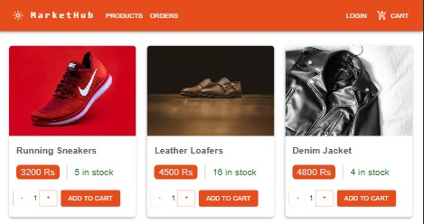
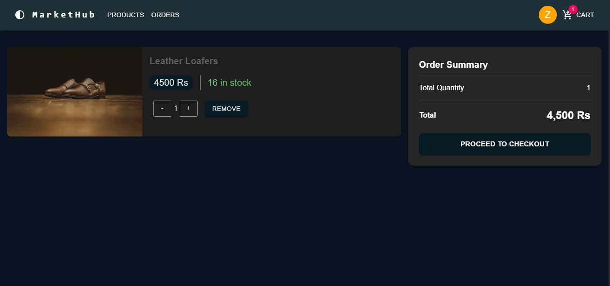
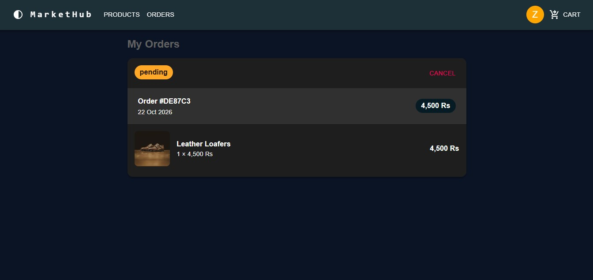
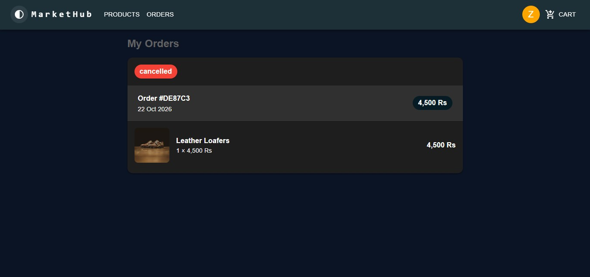
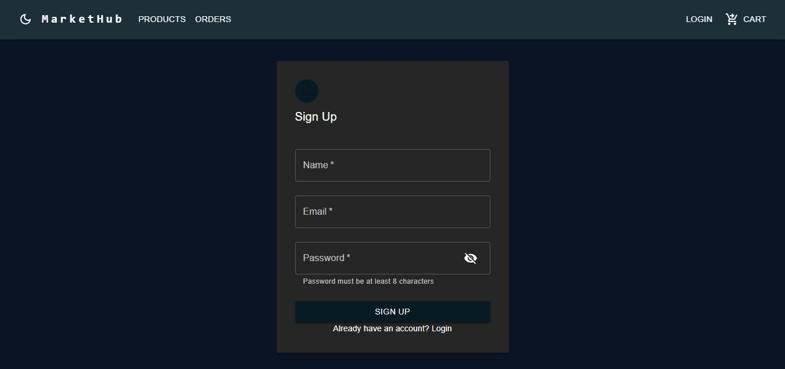

# MarketHub

A full-stack e-commerce web application built with the MERN stack. Users can browse products, manage a shopping cart, place orders and cancel them, while admins get access to protected management features. Authentication is handled with JWT, and access is controlled through user and admin roles.

**Live Demo:** [https://market-hub-frontend-zeta.vercel.app/]
**Backend API:** [https://market-hub-backend.vercel.app
```]


### User
- Register and log in securely (JWT authentication, passwords hashed with bcrypt)
- Browse the product listing
- Add products to the cart and update the cart
- Place an order from the cart
- View order history
- Cancel an order

### Admin
- Role-based access: admin-only routes are protected on the backend
- [view all orders, update order status]

### General
- Protected routes on both frontend and backend
- Server-side validation (required fields, minimum password length)
- Show/hide password toggle on login and register forms
- Responsive UI built with Material UI

## Tech Stack

**Frontend:** React (Vite), Redux Toolkit, React Router, Material UI, Axios
**Backend:** Node.js, Express.js
**Database:** MongoDB Atlas with Mongoose
**Authentication:** JSON Web Tokens (JWT), bcryptjs
**Deployment:** Vercel (frontend and backend deployed as separate projects)

## Project Structure

```
market-hub/
├── client/     # React frontend
└── server/     # Express backend (routes, controllers, models, middleware)
```

## API Overview

| Route              | Description                      |
|--------------------|----------------------------------|
| `/api/users`       | Register and login               |
| `/api/products`    | Product listing and management   |
| `/api/carts`       | Cart operations                  |
| `/api/orders`      | Place, view and cancel orders    |

Protected routes require a `Bearer` token in the `Authorization` header. Admin routes additionally require the `admin` role.

## Getting Started

### Prerequisites
- Node.js
- A MongoDB Atlas account (or a local MongoDB instance)

### Installation

```bash
git clone https://github.com/zeenat2026/Market-hub.git
cd Market-Hub
```

**Backend**
```bash
cd server
npm install
```
Create a `.env` file in `server/`:
```
MONGO_URI=your_mongodb_connection_string
JWT_SECRET=your_secret_key
PORT=5000
```
```bash
npm run dev
```

**Frontend**
```bash
cd client
npm install
```
Create a `.env` file in `client/`:
```
VITE_API_URL=https://market-hub-backend.vercel.app
```
```bash
npm run dev
```

## Screenshots







## Author
**Zeenat Shafqaat**
[LinkedIn](https://www.linkedin.com/in/zeenat-shafqaat/) · [GitHub](https://github.com/zeenat2026/Market-Hub)


First request may take a few seconds to wake up the server.